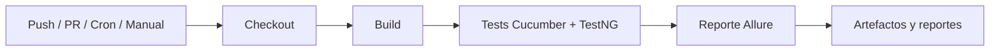
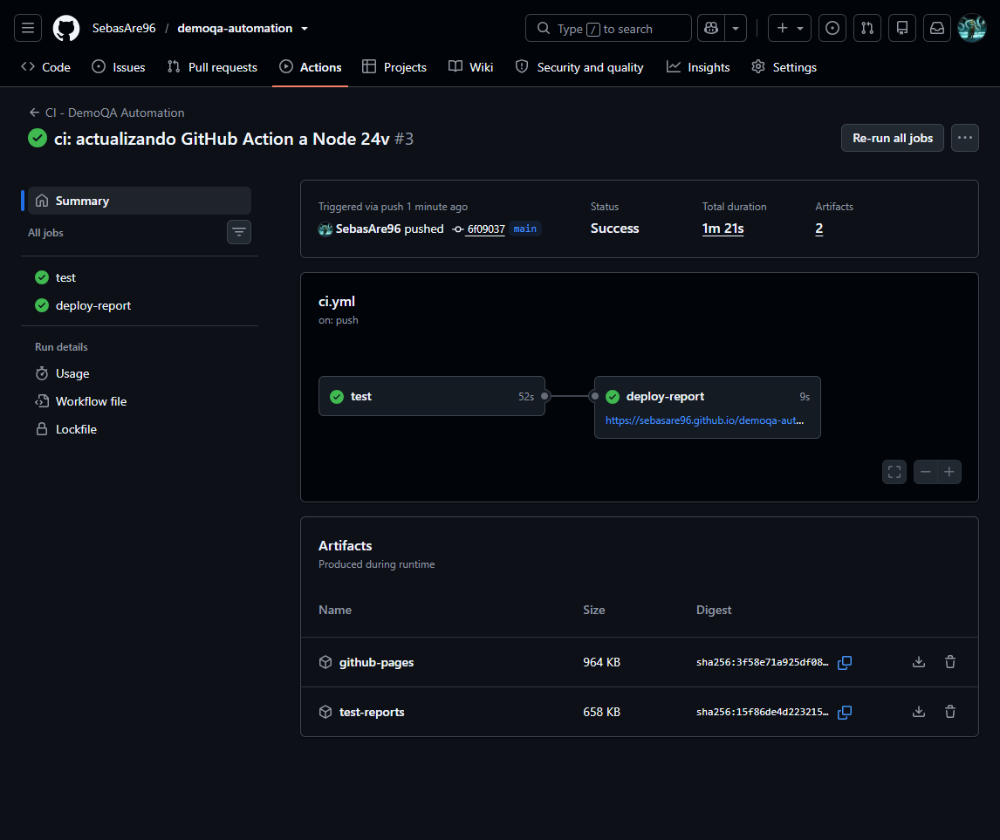
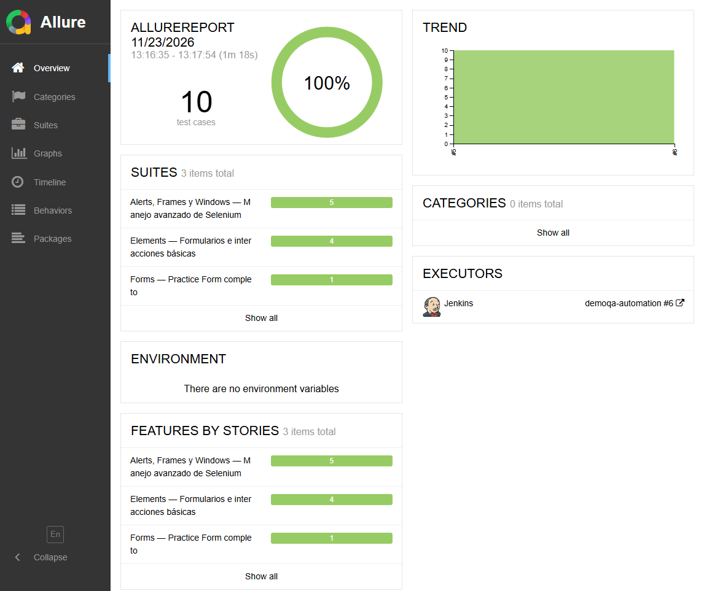

# DemoQA Automation

[](https://github.com/SebasAre96/demoqa-automation/actions/workflows/ci.yml)


Framework de automatización de pruebas UI para [demoqa.com](https://demoqa.com), construido con **Java + Selenium +
Cucumber (BDD)**, con integración continua en **GitHub Actions** y **Jenkins** y reportes **Allure**.

📊 **[Ver último reporte Allure](https://sebasare96.github.io/demoqa-automation/)**

## Stack

| Área              | Tecnología                                 |
|-------------------|--------------------------------------------|
| Lenguaje          | Java 17                                    |
| Automatización UI | Selenium WebDriver 4.18 + WebDriverManager |
| BDD               | Cucumber 7.15 (Gherkin)                    |
| Runner            | TestNG 7.9                                 |
| Aserciones        | AssertJ                                    |
| Reportes          | Allure 2.25 + reporte HTML de Cucumber     |
| Build             | Maven                                      |
| CI/CD             | GitHub Actions y Jenkins                   |

## Cobertura

23 escenarios agrupados en 4 features:

| Feature             | Qué cubre                                                                 |
|---------------------|---------------------------------------------------------------------------|
| `01_elements`       | Text Box, checkbox, radio buttons, Web Tables, double click y right click |
| `02_forms`          | Practice Form completo, validaciones de campos requeridos                 |
| `03_alerts_windows` | Alerts (simple, confirm, prompt), nuevas ventanas, iframes y modals       |
| `04_interactions`   | Drag & Drop, Sortable y Selectable                                        |

## Estructura del proyecto

```
.
├── .github/workflows/ci.yml       # Pipeline de GitHub Actions
├── Jenkinsfile                    # Pipeline de Jenkins
├── pom.xml
├── testng.xml
└── src
    ├── main/java/.../DemoQA
    │   ├── Pages/                 # Page Object Model
    │   ├── config/ConfigReader    # Configuración (propiedades, env vars, config.properties)
    │   └── driver/DriverManager   # WebDriver en ThreadLocal
    └── test
        ├── java/.../DemoQA
        │   ├── runner/            # TestRunner y Hooks (setup/teardown, screenshots)
        │   └── steps/             # Step definitions
        └── resources
            ├── config.properties
            └── features/          # Escenarios Gherkin
```

## Decisiones de diseño

- **Page Object Model** para separar la lógica de las páginas de los steps.
- **`DriverManager` con `ThreadLocal`**, lo que deja el framework listo para ejecución en paralelo.
- **Configuración con prioridad:** propiedad de sistema (`-Dbrowser=...`) → variable de entorno → `config.properties`.
  El mismo código corre en local y en CI sin cambios.
- **Screenshots automáticos** adjuntos al reporte cuando falla un escenario.
- **Tags Cucumber** para elegir suites (`@smoke`, `@ignore` para escenarios inestables en headless).

## Ejecución local

Requisitos: **JDK 17**, **Maven** y Chrome o Firefox instalado.

```bash
# Suite completa (excepto @ignore)
mvn clean test -Dcucumber.filter.tags="not @ignore"

# Solo smoke, en Chrome headless
mvn clean test -Dbrowser=chrome -Dheadless=true -Dcucumber.filter.tags="@smoke and not @ignore"

# En Firefox
mvn clean test -Dbrowser=firefox -Dheadless=true
```

| Parámetro  | Valores             | Por defecto          |
|------------|---------------------|----------------------|
| `browser`  | `chrome`, `firefox` | `chrome`             |
| `headless` | `true`, `false`     | `false`              |
| `base.url` | URL del sitio       | `https://demoqa.com` |
| `timeout`  | segundos            | `10`                 |

### Ver el reporte Allure en local

```bash
mvn allure:serve
```

## CI/CD

El proyecto tiene dos pipelines con el mismo objetivo, para mostrar ambos enfoques.



### GitHub Actions (`.github/workflows/ci.yml`)

- **Se dispara** en push y pull request a `main`, todos los días hábiles a las 06:00 UTC (cron) y manualmente
  (`workflow_dispatch`, eligiendo browser y suite).
- Corre en Ubuntu con JDK 17 y caché de Maven, en modo headless.
- Por defecto ejecuta la suite **smoke**; la corrida manual permite elegir **regression**.
- Sube los reportes como artefactos y **publica el reporte Allure en GitHub Pages**.

> Para activar Pages: *Settings → Pages → Source: GitHub Actions*.

### Jenkins (`Jenkinsfile`)

Pipeline declarativo con parámetros `BROWSER`, `HEADLESS` y `SUITE`.

| Stage    | Descripción                                                                                      |
|----------|--------------------------------------------------------------------------------------------------|
| Checkout | Limpia el workspace y muestra el commit                                                          |
| Build    | `mvn clean compile`                                                                              |
| Tests    | `mvn test` con browser y tags según parámetros                                                   |
| Post     | Publica resultados JUnit, reporte Allure y archiva el HTML de Cucumber (aunque fallen los tests) |

**Requisitos en Jenkins:**

- Plugins: Pipeline, JUnit, Allure, GitHub.
- Una herramienta Maven llamada `Maven` en *Manage Jenkins → Tools*.
- JDK 17 y Chrome/Firefox disponibles en el agente.
- Para el trigger `githubPush()`, Jenkins debe ser accesible desde internet (webhook de GitHub); en una instalación
  local se puede lanzar el build manualmente o usar un túnel.

### Capturas

**GitHub Actions**



**Jenkins**


**Reporte Allure**


-->

## Suites disponibles

| Suite        | Filtro de tags           | Uso                            |
|--------------|--------------------------|--------------------------------|
| `smoke`      | `@smoke and not @ignore` | Validación rápida en cada push |
| `regression` | `not @ignore`            | Corrida completa               |

## Roadmap

- [ ] Ejecución en paralelo (el `ThreadLocal` ya está preparado)
- [ ] Ejecución en contenedores Docker (Selenium Grid)
- [ ] Historial de tendencias en Allure
- [ ] Reintentos automáticos para escenarios inestables

## Autor

[@SebasAre96](https://github.com/SebasAre96)
